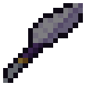
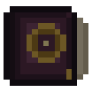
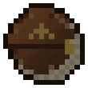
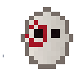

---
hide:
  - toc
---

# Witch's Atelier

A Minecraft mod where magic is drawn, not chosen from a menu.

Take a pen, dip it in ink and draw on a wall, the floor, a page or a pair of shoes: a ring, an element in its middle and signs around it. Close the ring and the glyph comes alive. What the spell does depends only on what you drew and how well you drew it.

For NeoForge 1.21.1.

<video autoplay muted loop playsinline preload="metadata" poster="assets/clips/beacon_of_birds.jpg"><source src="assets/clips/beacon_of_birds.webm" type="video/webm"></video>

<a class="section" href="getting-started/"><strong>Getting started</strong>Your first pen, ink and glyph</a><a class="section" href="glyphs/"><strong>How glyphs work</strong>Size, neatness, wear, nesting, linking</a><a class="section" href="reference/"><strong>Sigils and signs</strong>Every symbol you can draw</a><a class="section" href="spells/"><strong>Spells</strong>All 38 glyphs from the grimoires</a><a class="section" href="inks/"><strong>Inks and tools</strong>Brewing ink, pens and wands</a><a class="section" href="artifacts/"><strong>Artifacts</strong>Crafted dormant, woken with a glyph</a><a class="section" href="creatures/"><strong>Creatures</strong>Brimhats, knights and the Stranger</a><a class="section" href="pact/"><strong>The Pact</strong>What is forbidden, and who comes</a>

## Controls

| Action | How |
| --- | --- |
| Draw | Hold Use with a loaded pen on a surface and move your view |
| Rub out | Sneak while drawing, or wipe with a rag |
| Draw on a page | Paper or a palm quire in the other hand, Use in the air |
| Close a prepared ring | ++v++ with the page in hand |
| Tear a page out of a palm quire | ++t++ while it is open |
| Pin a grimoire glyph for tracing | ++shift++, scroll to size it |
