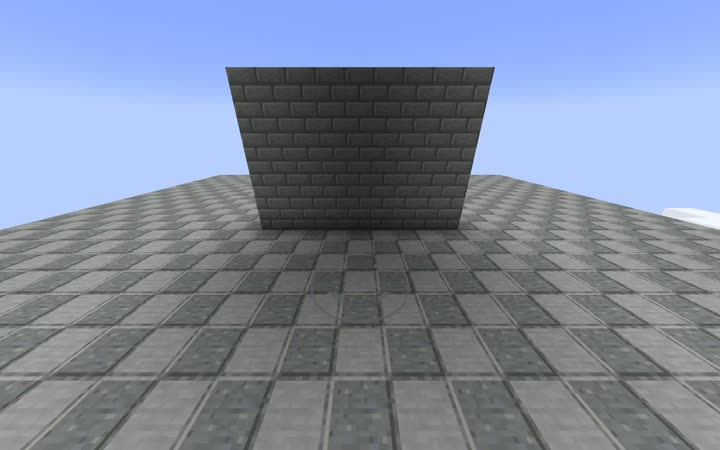

# Spells

Every glyph found in the grimoires, by element. Pick one to see how it is drawn, what it is made of and what it does. Counts are what the books draw; most spells still work with more or fewer signs, only weaker or stronger.

## Fire

<a class="tile" href="fire/#pillar-of-flame">Pillar of Flame</a><a class="tile" href="fire/#fire-bolts">Fire Bolts</a><a class="tile" href="fire/#sentinel-bolts">Sentinel Bolts</a><a class="tile" href="fire/#pillar-and-volley">Pillar and Volley</a><a class="tile" href="fire/#fan-of-flame">Fan of Flame</a><a class="tile" href="fire/#warming-hearth">Warming Hearth</a><a class="tile" href="fire/#snare-of-flame">Snare of Flame</a><a class="tile" href="fire/#pyreball-seal">Pyreball Seal</a><a class="tile" href="fire/#ring-of-fire">Ring of Fire</a>

## Water

<a class="tile" href="water/#spilling-water">Spilling Water</a><a class="tile" href="water/#water-jet">Water Jet</a><a class="tile" href="water/#rainflinger">Rainflinger</a><a class="tile" href="water/#rising-platform-of-water">Rising Platform of Water</a><a class="tile" href="water/#water-cage">Water Cage</a><a class="tile" href="water/#water-horse">Water Horse</a>

## Earth

<a class="tile" href="earth/#quickening-soil">Quickening Soil</a><a class="tile" href="earth/#stone-breaker">Stone Breaker</a><a class="tile" href="earth/#integration">Integration</a><a class="tile" href="earth/#earthen-wall">Earthen Wall</a><a class="tile" href="earth/#rising-earth">Rising Earth</a><a class="tile" href="earth/#mire">Mire</a><a class="tile" href="earth/#beast-repellent">Beast Repellent</a><a class="tile" href="earth/#wall-bend">Wall Bend</a>

## Wind

<a class="tile" href="wind/#wind-underfoot">Wind Underfoot</a><a class="tile" href="wind/#gathering-wind">Gathering Wind</a><a class="tile" href="wind/#gathering-breeze">Gathering Breeze</a><a class="tile" href="wind/#feather-fall">Feather Fall</a><a class="tile" href="wind/#sylph-step">Sylph Step</a><a class="tile" href="wind/#breath-of-the-deep">Breath of the Deep</a><a class="tile" href="wind/#floating-drops">Floating Drops</a><a class="tile" href="wind/#wall-of-wind">Wall of Wind</a>

## Light

<a class="tile" href="light/#lantern">Lantern</a><a class="tile" href="light/#birds-of-light">Birds of Light</a><a class="tile" href="light/#beacon-of-birds">Beacon of Birds</a><a class="tile" href="light/#rain-of-light">Rain of Light</a><a class="tile" href="light/#sunlit-spill">Sunlit Spill</a><a class="tile" href="light/#lance-of-light">Lance of Light</a><a class="tile" href="light/#binding-threads">Binding Threads</a><a class="tile" href="light/#floatglow-lamp">Floatglow Lamp</a>

## Signs alone

<a class="tile" href="signs-alone/#windowway">Windowway</a><a class="tile" href="signs-alone/#crystal-ward">Crystal Ward</a><a class="tile" href="signs-alone/#night-eye">Night Eye</a><a class="tile" href="signs-alone/#veil-of-unseeing">Veil of Unseeing</a><a class="tile" href="signs-alone/#puppet-dance">Puppet Dance</a><a class="tile" href="signs-alone/#seal-of-obliviation">Seal of Obliviation</a>

## Nested glyphs

<a class="tile" href="nested/#great-lantern">Great Lantern</a><a class="tile" href="nested/#everburning-pillar">Everburning Pillar</a><a class="tile" href="nested/#tidal-ring">Tidal Ring</a><a class="tile" href="nested/#steam-pillar">Steam Pillar</a><a class="tile" href="nested/#bed-of-sand">Bed of Sand</a>

## Forbidden

<a class="tile" href="forbidden/#petrification">Petrification</a>

